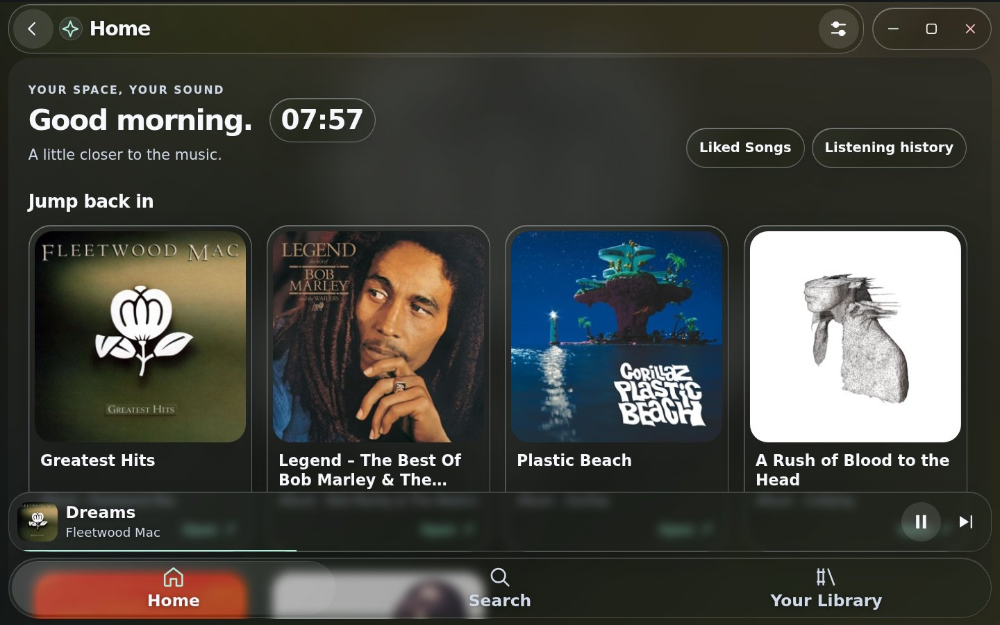
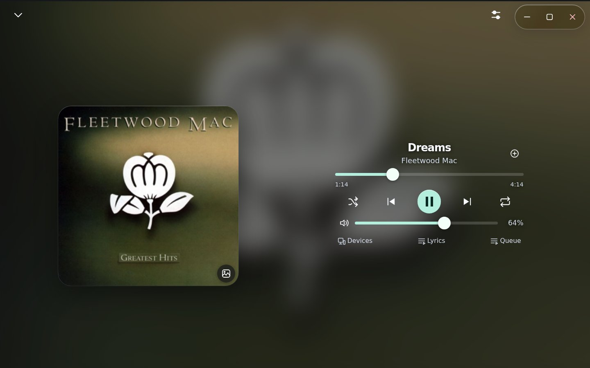

# LiquidTouch

A Spicetify theme and companion extension that turns Spotify desktop into a
mobile-style music interface for touchscreens, mini PCs and dedicated music
panels. LiquidTouch combines large, readable controls with artwork-colored
backgrounds and an Apple Liquid Glass inspired design: translucent surfaces,
rounded cards, soft highlights and responsive motion.

Spotify continues to handle playback, your account and the music catalog.
LiquidTouch provides the touch interface around it.

**[Download the latest full release](https://github.com/OrbitalShift4/Spotify-LiquidTouch/releases/latest)**
· [All releases and patch notes](https://github.com/OrbitalShift4/Spotify-LiquidTouch/releases)
· [Screenshot gallery](docs/screenshots/README.md)



## What it does

- **Home, Search and Library:** floating navigation, large cards, up to four
  columns, live search previews, entity detail pages and saved search-item cards.
- **Touch controls:** single tap to play, double tap to explore, hold for context
  actions, swipe between tabs, swipe from the left edge to go Back, and pull
  down for Quick Search. Gesture distances and animation speeds are adjustable.
- **Now Playing:** an app-filling artwork view, playback/volume/seek controls,
  incoming track-artwork swipes, Spotify Connect devices and an owned queue panel.
- **Lyrics:** optional synchronized lyrics, active-line tracking, tap-to-seek,
  alternate sources and per-song timing correction when available.
- **Accessibility:** independent text/interface sizing, player text/control/lyric
  sizing, adjustable artwork, a local on-screen keyboard, Reduce Motion and
  universal or per-surface glass opacity. Blur and corner rounding are adjustable.
- **Listening history:** local timestamps and search, Unlimited retention or
  an optional song limit that replaces the oldest plays, plus confirmed Clear.
- **Personalization:** time-of-day greetings, custom welcome text and an optional
  12/24-hour clock. Settings and history survive normal LiquidTouch updates.
- **Updates:** built-in Update/Later offers and patch notes. The official feed
  is already filled in for new installations; custom feed URLs are preserved.
- **Low-RAM mode:** optional smaller caches, less preloading and simpler effects
  for limited PCs, while retaining the touch interface.

## Pictures and interactive demo

The [gallery](docs/screenshots/README.md) includes Home, Now Playing, Library,
Search, Listening history and the touch context menu. These are screenshots of
the production interface using a simulated host, with **real songs, artists,
albums and covers** selected at random. Playback and listening timestamps are
simulated. No Spotify account or private library is shown.



For an interactive look, download the full ZIP and open
**LiquidTouch/LiquidTouch-Gallery.html** in a desktop browser. It runs offline,
plays no audio and needs no account. **LiquidTouch-Preview.html** is the separate
fictional-data fixture used for automated tests. Gallery catalog and artwork
credits are in [the gallery page](docs/screenshots/README.md#music-and-artwork).

## v1.9.5

The revised build (`2026-11-03-r1`) repairs full/Quick Search, adds continuous
Backspace deletion and prevents artwork dragging during card holds. Existing
1.9.5 users must download the revised full ZIP and rerun the installer: the
current updater only accepts higher versions. Settings/history retain their
existing storage keys. This revision passed 12 simulated-host regression suites;
live Spotify and browser interaction were unavailable. See the packaged
`VALIDATION.md` for the exact checks and historical results.


This release centers the lyrics-off player, adds the history search keyboard,
reveals incoming pages during swipes, anchors/animates hold menus, resolves
Spotify’s Song Radio playlist with the selected track first, hardens the first
search of a session and adds optional Low-RAM mode.

[Full v1.9.5 notes](https://github.com/OrbitalShift4/Spotify-LiquidTouch/releases/tag/v1.9.5)
include the update path and validation limits.

## Install

You need Spotify desktop and a working, compatible
[Spicetify installation](https://spicetify.app/docs/getting-started). LiquidTouch
includes both a theme and an extension; installing only the colors will not
provide its touch navigation and player. A 1024 × 600 landscape display is a
useful starting point. Layouts also support smaller and portrait windows;
large accessibility settings may require scrolling.

### Windows

1. Open [the latest release](https://github.com/OrbitalShift4/Spotify-LiquidTouch/releases/latest).
2. Under Assets, download **LiquidTouch-vX.Y.Z.zip** and extract the **entire** ZIP.
3. Read **LiquidTouch/README.md** for prerequisites and the install instructions.
4. Close Spotify and run the included **Install-Windows.ps1** as described there.
5. Reopen Spotify. Set your text/interface sizes in LiquidTouch Settings.

The installer backs up the relevant theme/configuration before applying it.
The package also includes manual installation and Linux/macOS helpers. Spotify
and Spicetify compatibility problems must be resolved before applying a theme.

## Update an existing installation

On a compatible LiquidTouch 1.9.0+ loader, open **Settings → Updates → Check now**,
read the offer and choose **Update** or **Later**. Updates replace the runtime
and styles together, show brief notes on first launch and preserve settings,
lyric timing and local history. New loader/installer requirements are described
in the release notes when applicable.

The official feed is prefilled in v1.9.2 and later. For an older compatible loader,
set **Release feed URL** to:

```text
https://raw.githubusercontent.com/OrbitalShift4/Spotify-LiquidTouch/main/latest.json
```

Keep **Check for updates** enabled for offers. Updates are installed only after
you choose Update. Local runtime JSON import is also supported. **Restore
installed version** returns to the normally installed package, which can be
older than the immediately preceding runtime update.

## Troubleshooting and feedback

Use **Settings → History & help → Desktop interface** to reach Spotify’s desktop
view. Include your LiquidTouch, Spotify and Spicetify versions, screen size,
text/interface scales and reproduction steps when reporting a problem.

Spotify’s internal APIs and desktop layout can change. The included tests run
against a simulated host; a release’s validation notes explain what was checked.
Devices, lyrics and some actions depend on what your Spotify session exposes.
History is local to the profile/device and can be lost if profile data is removed.

**Ideas, recommendations and suggestions are welcome.**
[Open an issue](https://github.com/OrbitalShift4/Spotify-LiquidTouch/issues) for
feedback or bugs. Please omit account credentials and private configuration.

LiquidTouch is independent of Spotify and Apple. Original LiquidTouch source
and fictional fixture artwork use the included MIT license. Real music artwork
in the gallery remains the property of its respective owners.
