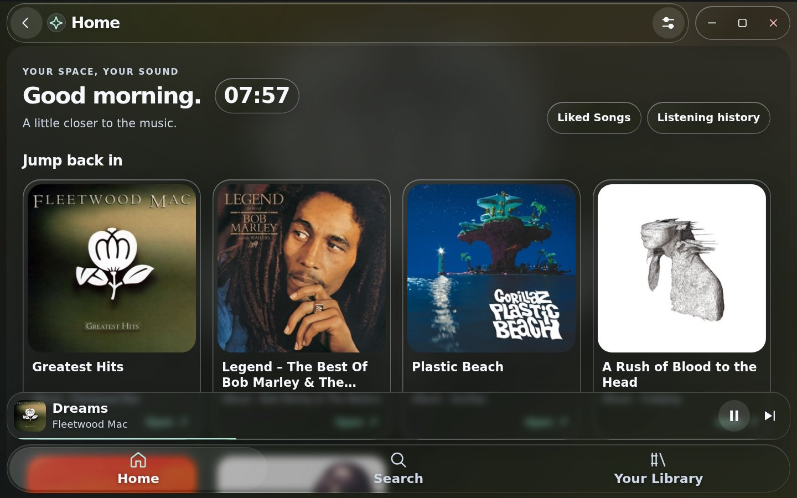
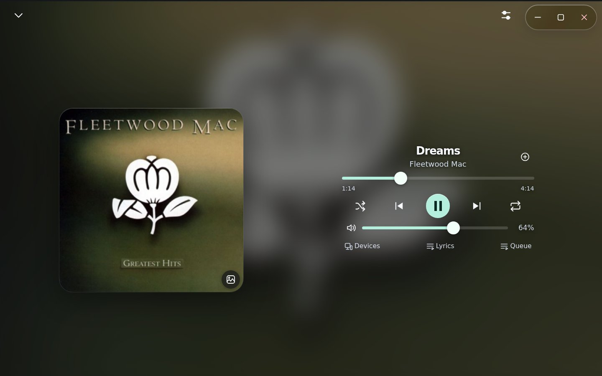
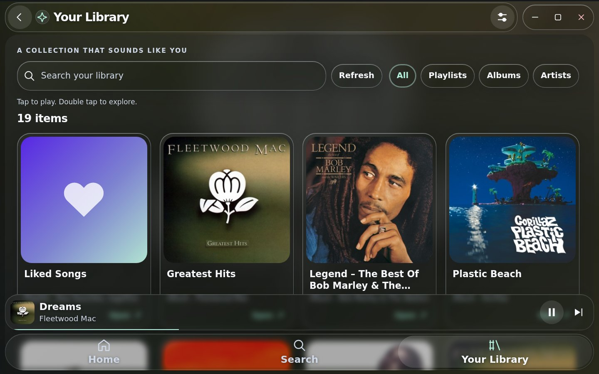
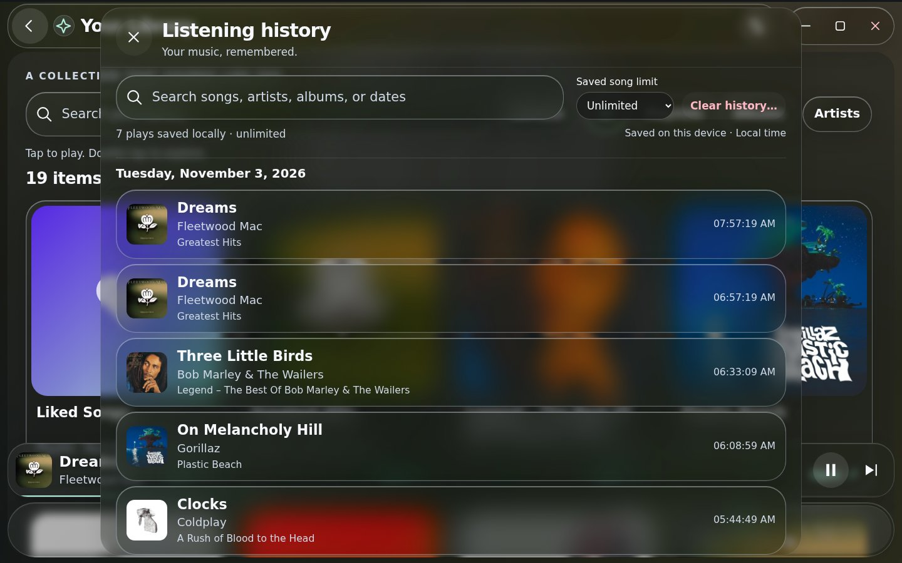
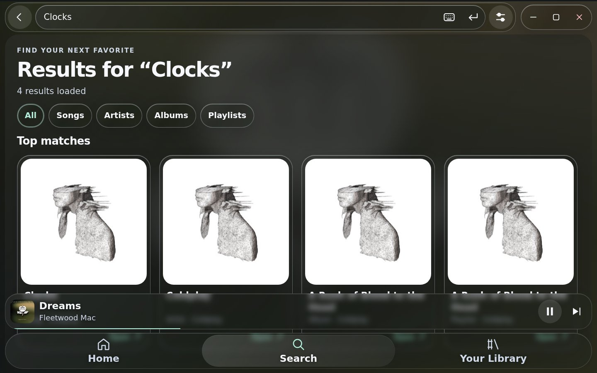
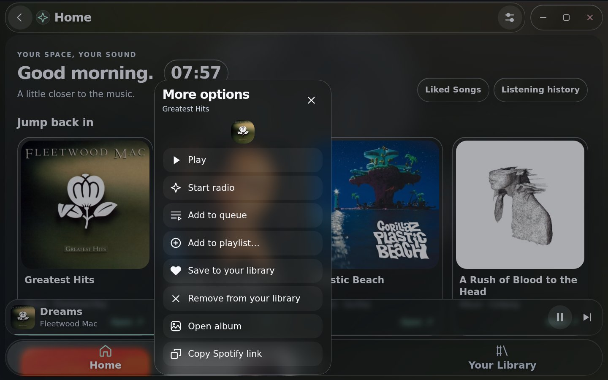

# LiquidTouch screenshot gallery

Screenshots of LiquidTouch v1.9.5 at 1440 × 900, with 130% text and 120% interface
scaling. The production extension and CSS run unchanged against a simulated host.
The songs, artists, albums and covers are real; the library, playback and listening
timestamps are demonstration data. No Spotify account or private library is shown.

For an interactive offline demo, download the full release ZIP and open
**LiquidTouch/LiquidTouch-Gallery.html**. It plays no audio. The separate
**LiquidTouch-Preview.html** uses fictional recordings for repeatable tests.

## Home

Adaptive artwork color, four-column cards, a time-of-day greeting and optional clock.

## Now Playing

Lyrics-off layout with centered title/artist and controls beside the artwork.

## Library

Larger cards with filters and a dedicated touch scroller.

## Listening history

A local journal with search, timestamps, retention controls and confirmed Clear.

## Search

Owned result cards for songs, artists, albums and playlists.

## Touch menu

An anchored action sheet from a held card, also available by right-click.

## Music and artwork

Six recordings were randomly selected from a candidate pool and verified against
public Apple music-catalog metadata on 3 November 2026. Catalog editions are shown
below, so a compilation cover can differ from the song’s original album cover.
No song audio or real lyric text is included in this demo.

| Song | Artist | Catalog edition |
| --- | --- | --- |
| [Dreams](https://music.apple.com/us/album/dreams/202271826?i=202272624&uo=4) | Fleetwood Mac | Greatest Hits |
| [Three Little Birds](https://music.apple.com/us/album/three-little-birds/1469575763?i=1469575900&uo=4) | Bob Marley & The Wailers | Legend – The Best Of Bob Marley & The Wailers |
| [On Melancholy Hill](https://music.apple.com/us/album/on-melancholy-hill/850569437?i=850569480&uo=4) | Gorillaz | Plastic Beach |
| [Clocks](https://music.apple.com/us/album/clocks/1122775993?i=1122776156&uo=4) | Coldplay | A Rush of Blood to the Head |
| [Feather (feat. Cise Starr & Akin)](https://music.apple.com/us/album/feather-feat-cise-starr-akin/1078923064?i=1078923526&uo=4) | Nujabes | Kei Nishikori Meets Nujabes |
| [No Ordinary Love](https://music.apple.com/us/album/no-ordinary-love/158796559?i=158796562&uo=4) | Sade | Love Deluxe |

Album artwork remains the property of the respective artists, labels and other
rights holders. It is included to demonstrate the interface and is not covered
by LiquidTouch’s MIT license. Catalog links above identify the source editions.

To contribute screenshots, open a GitHub issue with your screen/text/interface
sizes and omit account details or private playlists. Ideas and recommendations
are welcome.
